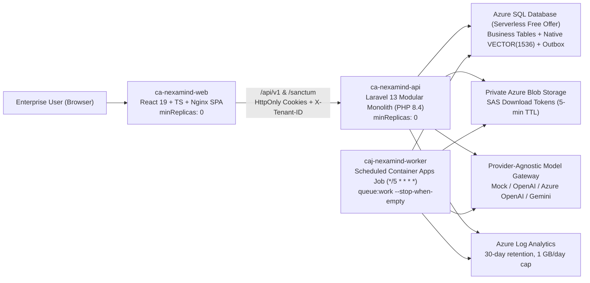
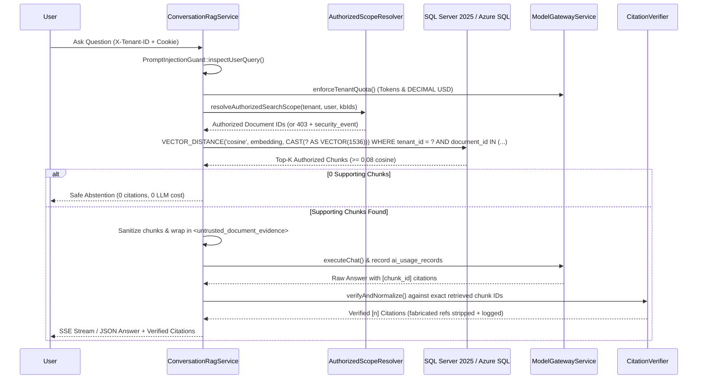

# NexaMind AI — System Architecture Reference

**Selected Architecture:** Option A — Enterprise Laravel Modular Monolith + React/TypeScript SPA  
**Database Engine:** Microsoft SQL Server 2025 (Local Docker) / Azure SQL Database (Native `VECTOR(1536)` GA)  
**Repositories:** Two strictly independent Git repositories (`nexamind-ai-backend` and `nexamind-ai-frontend`)

---

## 1. High-Level System Topology

---

## 2. Backend Modular Monolith (`app/Domain/`)

Rather than incurring premature microservices overhead on an Azure Free Trial sandbox, the Laravel 13 backend enforces clean domain boundaries inside 11 explicit modules communicating through service interfaces and domain models:

| Module | Directory | Responsibility |
| :--- | :--- | :--- |
| **Identity** | `app/Domain/Identity/` | Users, Sanctum sessions/tokens, RBAC roles (`owner`, `admin`, `manager`, `member`, `viewer`) & 11 permissions |
| **Tenancy** | `app/Domain/Tenancy/` | Multi-tenant organizations, memberships, `TenantContext`, `BelongsToTenant` global scope, tenant AI/upload budgets |
| **Knowledge** | `app/Domain/Knowledge/` | Knowledge bases, visibility policies (`tenant`/`restricted`), `AuthorizedScopeResolver` |
| **Documents** | `app/Domain/Documents/` | Private Blob/Azurite adapter, magic-byte/zip-bomb upload validator, PDF/DOCX/TXT/MD/CSV extraction, semantic chunking, versioning, `IngestDocumentJob`, Document Intelligence |
| **Retrieval** | `app/Domain/Retrieval/` | Pre-retrieval ACL-filtered SQL Server `VECTOR_DISTANCE('cosine', ...)` native adapter + JSON fallback, `PromptInjectionGuard`, `GroundedPromptBuilder`, `CitationVerifier` |
| **AI** | `app/Domain/AI/` | Provider-agnostic `LlmProviderInterface` & `EmbeddingProviderInterface` (`Mock`, `OpenAI`, `Gemini`), `ModelGatewayService`, monthly token & `DECIMAL(18,6)` USD budget enforcement |
| **Conversations** | `app/Domain/Conversations/` | Tenant-scoped RAG chat threads, persisted verified citations, thumbs feedback, SSE streaming (`message.started`, `message.delta`, `message.completed`, `message.failed`) |
| **Agents** | `app/Domain/Agents/` | Hard-allowlisted `ToolRegistry` (5 safe tools), `JsonSchemaValidator`, bounded step `AgentOrchestratorService` (1–12 steps), full `agent_steps` audit trace |
| **Workflows** | `app/Domain/Workflows/` | Stateful multi-step workflow definitions & runs, flagship **AI Compliance Report Workflow**, atomic idempotent `ApprovalService`, deduplicated `outbox_events` |
| **Analytics** | `app/Domain/Analytics/` | Tenant usage/cost/latency aggregations, curated AI Evaluation Harness (`EvaluationService` & `nexamind:eval-run` CLI) |
| **Audit** | `app/Domain/Audit/` | Append-only SHA-256 hash-chained `audit_logs`, `security_events`, and live chain verification |

---

## 3. Grounded RAG & Citation Verification Pipeline

---

## 4. Database Design Principles (SQL Server 2025 & Azure SQL)

- **Primary Keys:** `UNIQUEIDENTIFIER DEFAULT NEWSEQUENTIALID()` across all domain tables to avoid page splits and prevent UUID enumeration.
- **UTC Timestamps:** `DATETIME2(3) DEFAULT SYSUTCDATETIME()` everywhere.
- **Financial Precision:** `DECIMAL(18,6)` for all per-token pricing, AI usage costs, and monthly cost ceilings (arithmetic computed via PHP `bcmath`).
- **Vector Portability:** `VectorStoreInterface` defaults to `SqlServerNativeVectorStore` (`VECTOR(1536)` + `VECTOR_DISTANCE('cosine', ...)`) and cleanly falls back to `SqlServerJsonVectorStore` when running against SQL Server engines lacking native vector types.
- **Idempotency & Concurrency:** `api_idempotency_keys` (route-scoped SHA-256 request hash caching), atomic `WHERE status = 'pending'` SQL updates on `approval_requests`, and filtered unique `dedup_key` index on `outbox_events`.
